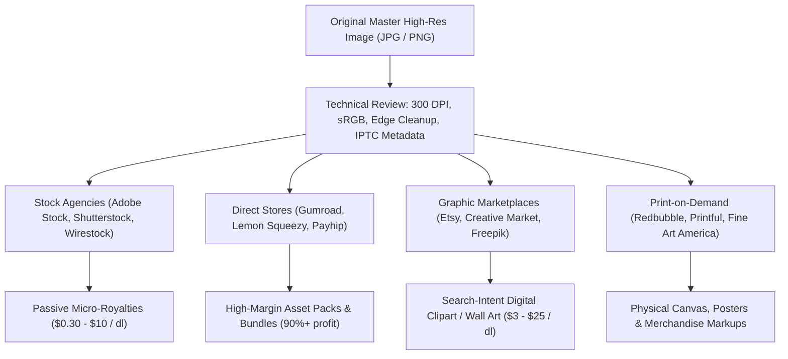

# Online Image Monetization Operator (`skills/online-image-monetization-operator`)

A comprehensive operational playbook for monetizing digital images (JPG, PNG, SVG, TIFF, PSD, RAW) online. This guide covers distribution channels, marketplace selection, technical preparation, licensing models, and platform economics.

---

## 1. Five Core Monetization Archetypes

| Model | Platforms | Best For | Typical Margins / Payout | Effort vs Passive Scale |
| :--- | :--- | :--- | :--- | :--- |
| **1. Stock Libraries (Microstock & Macrostock)** | Adobe Stock, Shutterstock, Getty Images / iStock, Alamy, Freepik, Depositphotos, Wirestock | High-volume photography, conceptual stock, realistic renders, 3D backgrounds | 15% – 50% royalty per download ($0.20 – $10+ per microstock DL; up to $50–$300 on Alamy/Getty extended licenses) | High upfront volume needed; completely passive once accepted |
| **2. Self-Hosted Digital Downloads / Creator Stores** | Gumroad, Lemon Squeezy, Shopify, Payhip, Ko-fi | Bundles, texture packs, photo reference packs, transparent PNG clipart packs, desktop wallpapers | 90% – 97% of retail price (pay standard ~3–10% payment processing fees) | Requires own audience, SEO, or paid traffic; highest margins |
| **3. Digital Print & Design Marketplaces** | Etsy, Creative Market, Design Cuts, Creative Fabrica, GraphicRiver (Envato) | Printable wall art (multisize JPG packs), graphic design elements, transparent PNG clipart, social media overlays | 50% – 85% revenue share (Etsy charges $0.20 listing + ~6.5% transaction fee) | Built-in search intent; moderate platform fees |
| **4. Print-on-Demand (POD)** | Redbubble, TeePublic, Printful, Printify, Society6, Fine Art America | Illustrations, digital art, photography turned into canvas prints, posters, apparel, mugs | 10% – 30% creator margin (you set markup over base product manufacturing cost) | Zero inventory; zero shipping/fulfillment burden |
| **5. Niche 3D, Game & Concept Art Marketplaces** | ArtStation, itch.io, Unity Asset Store, Unreal Engine Marketplace, CGTrader | Seamless textures, skyboxes, UI sprites, 2D game assets, matte paintings, concept art references | 70% – 88% revenue share | Specialized target audience with recurring professional budgets |

---

## 2. Technical File Standards by Format

### A. JPEG / JPG (Photographs, Renders, Wall Art, Backgrounds)
- **Resolution**: Minimum 4 MP to 12 MP for stock agencies (e.g., 4000 × 3000 px). For printable wall art: 300 DPI at full print size (e.g., 24×36 inches = 7200 × 10800 px).
- **Color Space**: **sRGB** (mandatory for digital display, web sales, and most stock agencies). Do not upload ProPhoto RGB or CMYK unless specifically catering to specialized high-end print houses.
- **Compression**: Save at Quality 10–12 (maximum quality, lowest compression) with zero visible artifacting at 100% zoom.
- **Embedded IPTC Metadata**:
  - `Title`: Clear, descriptive (avoid keyword stuffing).
  - `Description/Caption`: 1–2 factual sentences describing subjects, setting, lighting, action.
  - `Keywords/Tags`: 25–40 specific, relevant keywords (ordered by descending relevance).
  - `Copyright Notice`: © [Creator Name/Brand].

### B. PNG (Clipart, Cutouts, Overlays, Stickers, UI Assets)
- **Color Depth**: PNG-24 (24-bit RGB + 8-bit Alpha channel) for smooth semi-transparent feathering. Avoid 8-bit indexed PNG unless optimizing retro game pixel art.
- **Edge Cleanness**: Zero halo effects, fringing, or stray pixels around cutout masks.
- **Dimensions**: Large native canvas (e.g., 3000 × 3000 px at 300 DPI) to allow buyers to scale down without pixelation.

---

## 3. Licensing Tiers & Legal Protections

1. **Standard / Personal License**:
   - Buyer can use the image for personal projects, wallpapers, social media posts, or non-monetized content.
2. **Commercial License**:
   - Buyer can use the image in advertising, corporate websites, marketing campaigns, or YouTube videos up to a certain view/impression cap (e.g., 500,000 impressions). No resale of the image itself.
3. **Extended / Enhanced Commercial License**:
   - Permits resale of end-products where the image adds core value (e.g., printed on 10,000 mugs, t-shirts, book covers, software UI templates).
4. **Mandatory Legal Releases**:
   - **Model Release**: Required for any recognizable human face, identifiable body mark, or distinctive clothing. Without this, images must be sold as "Editorial Use Only".
   - **Property Release**: Required for recognized private properties, modern architecture, private art collections, trademarks, logos, brand emblems, or licensed vehicles.
   - **Editorial Use Only**: Permitted on stock platforms for news/documentary context only (events, street photography, recognizable brands); strictly prohibits commercial advertising use.

---

## 4. Multi-Channel Distribution Architecture

---

## 5. Wirestock & Aggregators Strategy

If you have hundreds or thousands of photos/renders and do not want to manually submit, tag, and key-word across 6 different agencies:
- **Wirestock**: One-stop distributor. You upload once; Wirestock's team or AI generates titles, descriptions, and tags, and submits them to Adobe Stock, Shutterstock, Getty Images/iStock, Freepik, Dreamstime, and Depositphotos. They take a ~15% cut of creator earnings in exchange for saving hundreds of hours of manual submission.

---

## Gemini (Antigravity) Execution SOP

1. **Determine the User's Image Type**:
   - Inquire or detect whether the images are: real photography, digital illustrations/clipart, 3D renders, AI-generated images, or photo textures.
2. **Map to Best Monetization Channel**:
   - General Photography $\rightarrow$ Adobe Stock + Wirestock + Alamy + Etsy printable wall art.
   - Transparent PNG / Clipart $\rightarrow$ Creative Fabrica + Creative Market + Etsy + Gumroad bundles.
   - Graphic Designs & Patterns $\rightarrow$ Redbubble/TeePublic (POD) + Spoonflower (fabric patterns).
3. **Deliver Step-by-Step Action Plan**:
   - Provide file preparation guidelines (resolution, format, DPI, metadata).
   - Outline account onboarding and payment gateways (PayPal, Stripe, Payoneer).
   - Warn against common rejection traps (compression noise, over-sharpening, missing model releases, trademark violations).

---

## Claude Execution SOP

1. Analyze asset types and target audience demographics.
2. Evaluate platform fee structures, exclusive vs non-exclusive agreements, and tax treaties (W-8BEN form for non-US residents).
3. Generate sample metadata tagging schemes and licensing contract clauses.
